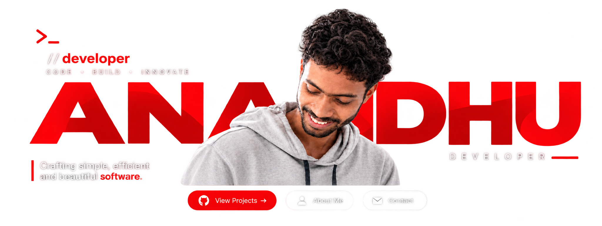

 

 

###  About Me

I'm **Anandhu**, a developer who enjoys turning ideas into reality through code. I love exploring new technologies, building useful tools, and constantly learning.

 

###  Tech Stack

  
  
  
  
  
  
  
  
  
  
  
  
  
  
  
  
  
  
  

 

###  Projects

<table>
  <tr>
    <td width="33%">
      <a href="https://github.com/YOUR_USERNAME/ketchup-os"><strong>🖥️ Ketchup OS</strong></a>
       
      A lightweight, minimal Linux distribution.
    </td>
    <td width="33%">
      <a href="https://github.com/YOUR_USERNAME/ketchup-web"><strong>🌐 Ketchup Web</strong></a>
       
      My personal website and portfolio.
    </td>
    <td width="33%">
      <a href="https://github.com/YOUR_USERNAME?tab=repositories"><strong>⭐ More Projects</strong></a>
       
      Check out my other work!
    </td>
  </tr>
</table>

 

---

❤️ Thanks for visiting!

